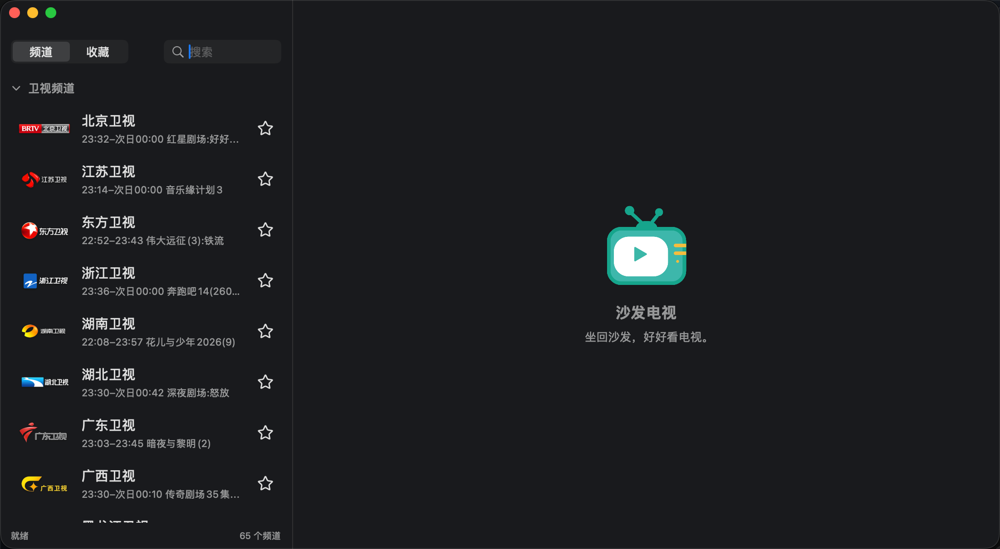
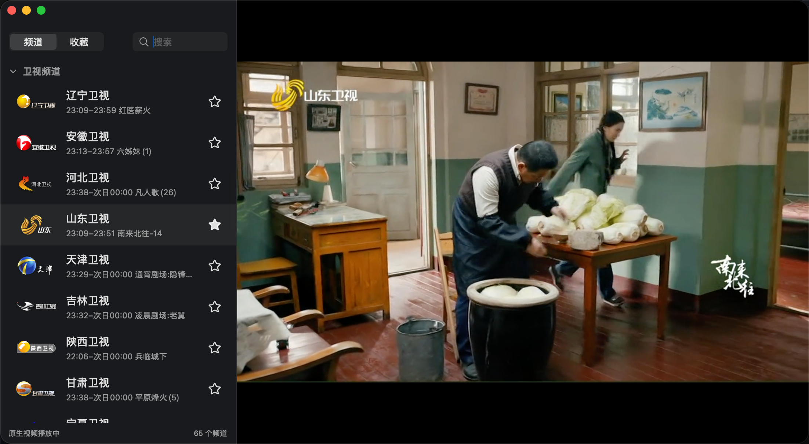

<div align="center">
  
  <h1>沙发电视</h1>
  <p><strong>坐回沙发，好好看电视。</strong></p>
  <p>为 macOS 设计的原生直播电视播放器。</p>
</div>

<p align="center">
  <a href="https://www.apple.com/macos/"></a>
  <a href="https://www.swift.org/"></a>
  <a href="LICENSE"></a>
</p>

<p align="center">
  <a href="https://github.com/ztygalaxy/SofaTV/releases"><strong>发布页</strong></a>
  · <a href="#使用">使用说明</a>
  · <a href="https://github.com/ztygalaxy/SofaTV/issues">问题反馈</a>
</p>

我一直很喜欢看电视。

客厅是一个家最有温度的地方：一家人围坐在一起，看节目、聊几句天，让平常的夜晚也慢慢暖起来。

工作以后，我始终没能在 Mac 上找到一款足够清爽的直播电视——我想要的其实很简单：打开，选台，然后安心地看；没有网页的喧闹，也不让一排播放器按钮打扰画面。

于是有了沙发电视。

希望它能把那种窝在沙发里、和家人一起看电视的感觉，带回每一个寻常的夜晚。

## 页面预览

<table>
  <tr>
    <td align="center"></td>
    <td align="center"></td>
  </tr>
  <tr>
    <td align="center"><strong>启动页面</strong><br><sub>打开应用，选择想看的频道</sub></td>
    <td align="center"><strong>播放中</strong><br><sub>选中频道后直接进入原生播放</sub></td>
  </tr>
</table>
<table>
  <tr>
    <td width="50%" align="center"></td>
    <td width="50%" align="center"></td>
  </tr>
  <tr>
    <td align="center"><strong>未播放</strong><br><sub>显示沙发电视 App 图标</sub></td>
    <td align="center"><strong>播放中</strong><br><sub>右上角显示当前频道台标</sub></td>
  </tr>
</table>
## 功能介绍

- **原生 macOS 体验**：SwiftUI + AppKit 界面，深色外观、可调整侧栏、窗口布局记忆和独立视频全屏。
- **频道库管理**：导入本地或在线 M3U/TXT 列表；重复频道增量合并，支持删除频道、线路、分组或整份导入列表。
- **频道台标**：内置常见电视台台标与别名匹配。
- **当前节目**：频道名下显示播出起止时间和正在播出的节目。
- **收藏与搜索**：按频道名或分组搜索，收藏频道，并持久保存筛选、分组折叠和导入数据。
- **音量与静音**：视频区域滚轮、点击或拖动音量条调节音量；新频道默认 30%，每个频道单独保存音量。点击喇叭静音，切台保持静音，再次点击恢复原音量。
- **播放控制**：切台、线路选择、清晰度、缓冲模式、画面拉伸、诊断信息和纯视频全屏；底部控件随鼠标活动显示，支持按钮或双击进入、退出视频全屏。

## 系统要求

- macOS 14 或更高版本
- Apple Silicon 或 Intel Mac
- 可访问相应直播源的网络环境

正式发布的版本会同时提供 `arm64` 和 `x86_64` 安装包。

## 频道列表

支持标准 M3U 和常见的逗号分隔 TXT 格式。最小的 M3U 列表如下：

```m3u
#EXTM3U
#EXTINF:-1 group-title="卫视频道",示例卫视
https://example.com/live.m3u8
```

TXT 列表可以用 `分组名,#genre#` 切换分组：

```text
卫视频道,#genre#
示例卫视,https://example.com/live.m3u8
```

单条 HTTP/HLS 地址不必做成列表，使用“频道 → 打开直播地址…”即可。

## 快捷操作

| 操作 | 快捷方式 |
| --- | --- |
| 上一个 / 下一个频道 | `↑` / `↓` |
| 降低 / 增大当前频道音量 | `←` / `→` |
| 进入或退出纯视频全屏 | 双击视频 |
| 退出全屏 | `Esc` |
| 导入频道文件 | `⌘O` |
| 导入在线列表 | `⇧⌘O` |
| 打开直播地址 | `⌘L` |

## 隐私说明

导入的频道列表、收藏、频道音量、分组状态以及窗口和侧栏大小只保存在本机，不会上传到项目服务器。

网页解析使用非持久化 WebKit 数据存储，原生请求使用内存 Cookie。播放所需的 Cookie 只在当前运行周期内传递，不会跨启动保留网站数据。

## 许可证与来源

沙发电视采用 [GNU GPL v3 only](LICENSE)（`GPL-3.0-only`）。第三方与派生源码继续适用各自文件中保留的版权和许可证；频道台标的来源与许可见 [频道台标来源](Assets/ChannelLogos/SOURCE.md)。

频道、网站、台标及外部媒体内容的权利归各自权利人所有。本项目不提供内容授权，也不保证任何外部直播源持续可用。使用和分发时请遵守所在地法律以及内容提供方条款。
