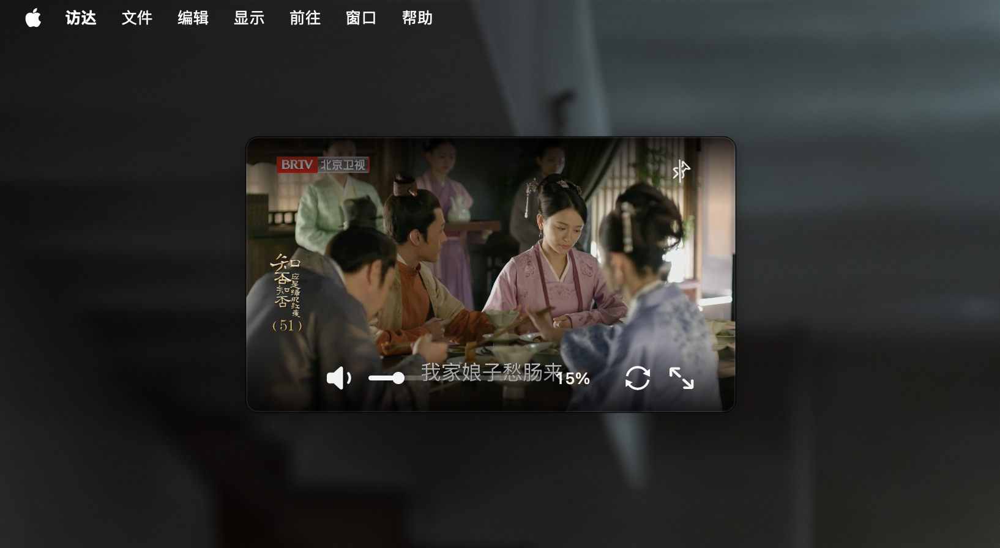
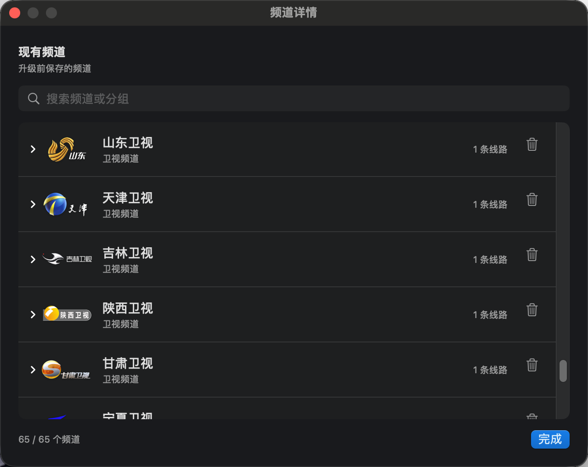

<div align="center">
  
  <h1>沙发电视</h1>
  <p><strong>坐回沙发，好好看电视。</strong></p>
  <p>为 macOS 设计的原生直播电视播放器，支持节目单预览、收藏和置顶小窗。</p>
</div>


<p align="center">
  <a href="https://www.apple.com/macos/"></a>
  
  <a href="LICENSE"></a>
</p>

<p align="center">
  <a href="https://github.com/ztygalaxy/SofaTV/releases/latest"><strong>下载沙发电视</strong></a>
  · <a href="#下载与上手">安装上手</a>
  · <a href="#使用指南">使用指南</a>
  · <a href="#常见问题">常见问题</a>
  · <a href="https://github.com/ztygalaxy/SofaTV/issues">问题反馈</a>
</p>
我一直很喜欢看电视：不用先决定看什么剧，调到哪台就看哪台。

客厅里，一家人围坐着，看节目、聊几句，平常的夜晚也会暖起来。

于是有了沙发电视。

工作以后，一家人团聚的机会少了，但我仍希望它能把那种窝在沙发里、和家人一起看电视的感觉带到 Mac，带到我的身旁。

## 界面预览

<p align="center">
  <a href="docs/images/program-guide-fullscreen-demo.gif"></a>
</p>
<table>
  <tr>
    <td width="20%" align="center"><a href="docs/images/app-idle.png"></a></td>
    <td width="20%" align="center"><a href="docs/images/app-playing.png"></a></td>
    <td width="20%" align="center"><a href="docs/images/app-fullscreen.png"></a></td>
    <td width="20%" align="center"><a href="docs/images/app-mini-player.png"></a></td>
    <td width="20%" align="center"><a href="docs/images/app-channel-manager.png"></a></td>
  </tr>
  <tr>
    <td align="center"><strong>启动页面</strong><br><sub>打开应用，选择想看的频道</sub></td>
    <td align="center"><strong>播放与节目单</strong><br><sub>查看当天排期，直播继续播放</sub></td>
    <td align="center"><strong>全屏与节目单</strong><br><sub>滑出频道列表，悬停浏览排期</sub></td>
    <td align="center"><strong>桌面小窗模式</strong><br><sub>置顶播放，自由拖动与缩放</sub></td>
    <td align="center"><strong>管理频道列表</strong><br><sub>搜索频道，管理频道与播放线路</sub></td>
  </tr>
</table>

<details>
<summary>Dock 中的频道标记</summary>

<table>
  <tr>
    <td width="50%" align="center"><a href="docs/images/dock-idle.png"></a></td>
    <td width="50%" align="center"><a href="docs/images/dock-playing.png"></a></td>
  </tr>
  <tr>
    <td align="center"><strong>未播放</strong><br><sub>显示沙发电视 App 图标</sub></td>
    <td align="center"><strong>播放中</strong><br><sub>右上角显示当前频道台标</sub></td>
  </tr>
</table>

</details>

## 主要功能

| 功能 | 说明 |
| --- | --- |
| 原生播放 | 优先使用原生播放，支持清晰度选择、直播延迟模式和画面拉伸。 |
| 节目单预览 | 悬停查看当天排期，自动定位当前时段；预览其他频道时，直播继续播放。 |
| 全屏选台 | 从画面左侧滑出毛玻璃频道列表，搜索、收藏、查看节目单或换台。 |
| 置顶小窗 | 一键缩成桌面小窗，自由拖动、按比例缩放，随时返回主窗口。 |
| 频道管理 | 导入本地或在线 M3U / TXT 列表，合并重复频道，按来源整理频道与线路。 |
| 观看习惯 | 本机保存收藏、频道音量、静音状态，以及窗口、侧栏和分组设置。 |

## 下载与上手

需要 **macOS 14 或更高版本**，支持 Apple Silicon 和 Intel Mac。前往 [最新版本](https://github.com/ztygalaxy/SofaTV/releases/latest)，下载对应的 DMG 或 ZIP 安装包。

| 你的 Mac | 安装包 |
| --- | --- |
| Apple Silicon（M 系列芯片） | `SofaTV-<版本>-arm64.dmg` / `.zip` |
| Intel 处理器 | `SofaTV-<版本>-x86_64.dmg` / `.zip` |

打开 DMG，将 **沙发电视.app** 拖入旁边的“应用程序”文件夹。使用 ZIP 时，解压得到与压缩包同名的 `.app`，将它拖入“应用程序”并打开；应用内仍显示“沙发电视”。

### 第一次使用

1. **加入频道**：选择“频道 → 恢复内置频道”，或导入自己的频道列表。
2. **选台播放**：点击左侧频道开始观看，用搜索框查找频道，点星标加入收藏。
3. **查看排期**：将鼠标停在频道上，打开节目单。

## 使用指南

### 频道与节目单

搜索框支持频道名和分组名，左上角可切换“频道 / 收藏”。拖动列表与视频之间的分隔线调整宽度，点击视频左侧的箭头收起或展开列表。正在播放的频道带有青色竖条，Dock 图标右上角也会显示当前频道台标。

悬停频道，右侧会滑出当天的节目单，并定位正在播出的节目。移入面板可滚动查看前后排期，点击“回到当前”返回当前时段，移回视频后面板自动收起。浏览其他频道的节目单不会切台。

正在观看的频道以青色标记“当前节目”；预览其他频道时，以白色标记“正在播出”。

### 全屏与置顶小窗

**全屏观看**：双击视频，或点击右下角全屏按钮。将鼠标移到画面左侧，滑出频道列表；悬停查看节目单，点击频道换台。鼠标移回右侧后列表自动收起。按 `Esc` 会依次收起节目单和频道列表；两者都未展开时，再按 `Esc` 退出全屏。

**置顶小窗**：点击视频右上角的图钉进入。拖动画面移动位置，拖动边缘按比例缩放；再次点击图钉、双击画面或按 `Esc` 返回主窗口。

全屏和小窗沿用当前播放，无需重新选台。移动鼠标可唤出视频操作按钮。

### 音量与播放

- **音量**：在视频区域滚动鼠标滚轮，或拖动右下角音量条；音量按频道记忆。
- **静音**：点击喇叭图标。切台时保持静音，再点一次恢复音量。
- **刷新**：点击音量与全屏按钮之间的刷新图标，重新连接当前线路。
- **播放选项**：在“播放”菜单中选择清晰度、“稳定 / 适中 / 低延迟”模式，或开启“拉伸画面”。

### 导入与整理频道

| 导入内容 | 菜单入口 |
| --- | --- |
| 本地 M3U / TXT 文件 | 频道 → 导入频道文件… |
| 在线 M3U / TXT 列表 | 频道 → 导入在线列表… |
| 单条直播地址 | 频道 → 打开直播地址… |

在“频道 → 管理频道列表…”中点击一份来源，查看具体频道；展开频道可复制或删除播放线路。主窗口的频道和分组也支持右键删除，手动换线路则使用“播放 → 播放线路”。

同名、同分组的频道会合并线路并保留来源。从来源详情中删除频道或线路，只影响该来源，其他来源提供的内容会保留。

<details>
<summary>M3U 与 TXT 格式示例</summary>

M3U 使用 `group-title` 指定分组：

```m3u
#EXTM3U
#EXTINF:-1 group-title="卫视频道",示例卫视
https://example.com/live.m3u8
```

TXT 使用“频道名,地址”，通过 `分组名,#genre#` 切换分组：

```text
卫视频道,#genre#
示例卫视,https://example.com/live.m3u8
```

示例地址仅用于说明格式，请替换为可用的直播地址。

</details>

### 快捷操作

| 快捷方式 | 操作 |
| --- | --- |
| `↑` / `↓` | 上一个 / 下一个频道 |
| `←` / `→` | 降低 / 增大当前频道音量 |
| 双击视频 | 切换普通窗口与全屏；小窗中双击返回主窗口 |
| `Esc`（全屏） | 先收起节目单和频道列表，再按退出全屏 |
| `Esc`（小窗） | 返回主窗口 |
| `⌘O` | 导入频道文件 |
| `⇧⌘O` | 导入在线列表 |
| `⌘L` | 打开直播地址 |

## 常见问题

<details>
<summary>为什么有些频道连接慢，或者无法播放？</summary>

连接速度取决于直播源、网络和来源网站的访问要求，部分网页来源需要先解析地址。可点击刷新重新连接，或在“播放 → 播放线路”中换一条线路；内置频道可通过“频道 → 恢复内置频道”重新导入。

沙发电视优先使用原生播放，网页来源在后台解析，必要时使用网页播放通道。

</details>

<details>
<summary>为什么部分频道没有节目单？</summary>

节目信息依赖节目单来源，以及频道名称、标识的匹配结果。匹配成功时会显示当前节目和当天已获取的排期，数据自动更新。不同频道的排期完整度可能不同；没有节目单也可以正常选台播放。

</details>

<details>
<summary>如何更新应用？</summary>

应用启动后会在后台检查更新。满 10 秒时还没开始看电视，有新版本才弹出提示；已经开始播放则不打扰本次观看。也可以随时选择“沙发电视 → 检查更新…”。

点击“下载并安装”会下载对应芯片的 ZIP 更新包，校验后替换应用并重新打开，保留频道与设置。也可以选择“稍后”或“跳过此版本”；跳过的版本仍可通过手动检查查看。

历史版本和更新说明见 [Releases](https://github.com/ztygalaxy/SofaTV/releases)。

</details>

## 数据与隐私

频道列表、收藏、频道音量、静音状态，以及分组、窗口和侧栏设置保存在本机，不上传到项目服务器。

播放直播和获取节目单会访问对应内容来源，检查更新会访问 GitHub。网页解析使用临时网站数据，播放所需的 Cookie 只在当前运行期间使用，不跨启动保留。

## 开发与贡献

应用使用 **Swift 6、SwiftUI、AppKit、AVKit 和 WebKit**。欢迎提交 [Issue](https://github.com/ztygalaxy/SofaTV/issues) 或 Pull Request。

本地构建需要 macOS 14+、Swift 6 工具链、Python 3 和 Clang。Swift 与 Clang 可由 Xcode 或 Command Line Tools 提供。

```sh
git clone https://github.com/ztygalaxy/SofaTV.git
cd SofaTV
./scripts/build-app.sh
```

产物位于 `dist/沙发电视.app`，包含原生播放所需的动态库、图标和资源。

生成当前芯片对应的 ZIP 和 DMG：

```sh
./scripts/package-app.sh
```

运行核心检查：

```sh
./scripts/test-core.sh
```

## 许可证与来源

沙发电视采用 [GNU GPL v3 only](LICENSE)（`GPL-3.0-only`）。第三方与派生源码继续适用各自文件中保留的版权和许可证；频道台标的来源与许可见 [频道台标来源](Assets/ChannelLogos/SOURCE.md)。

频道、网站、台标及外部媒体内容的权利归各自权利人所有。本项目不提供内容授权，也不保证任何外部直播源持续可用。使用和分发时请遵守所在地法律以及内容提供方条款。

内置播放列表仅用于测试与技术交流。如涉及侵权，请[联系我](mailto:zhangty1996@163.com)删除。
