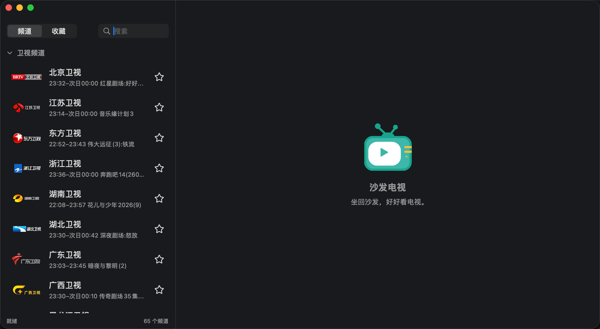
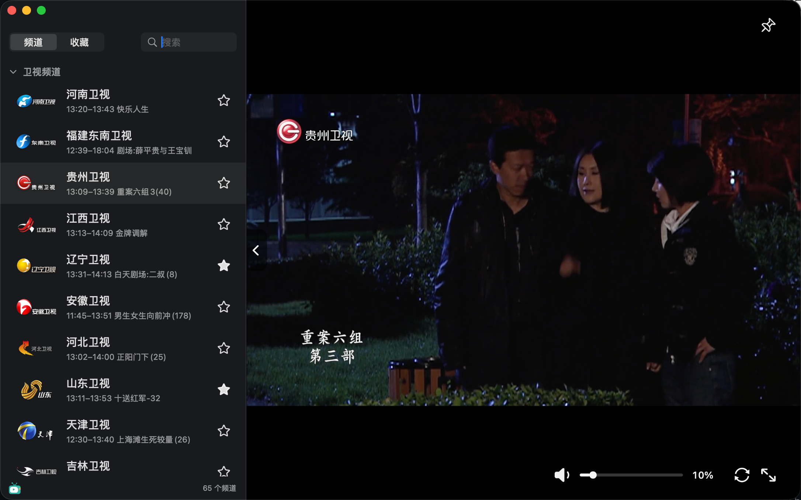
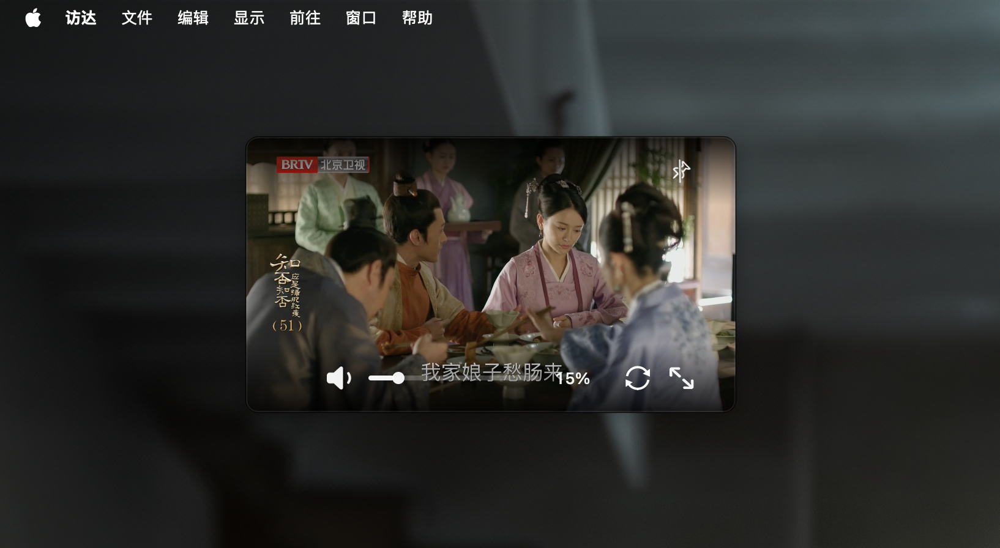
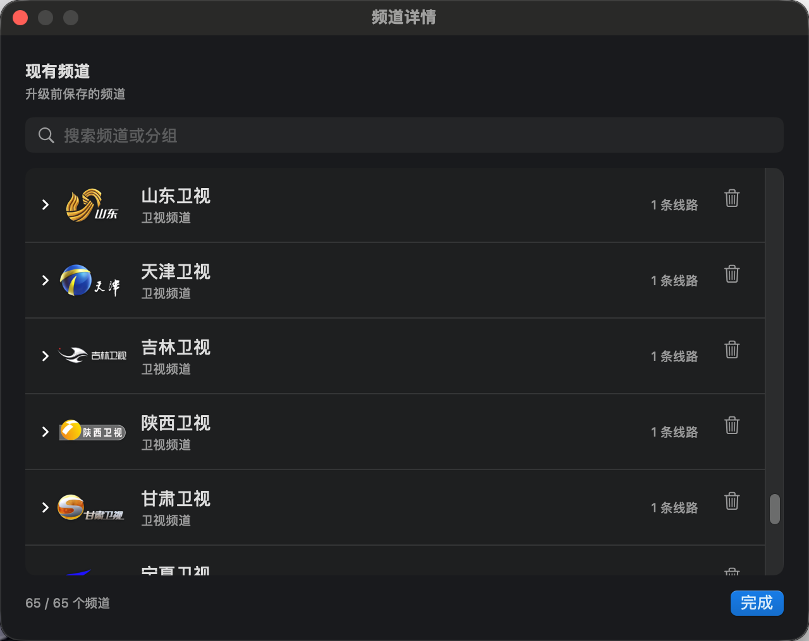
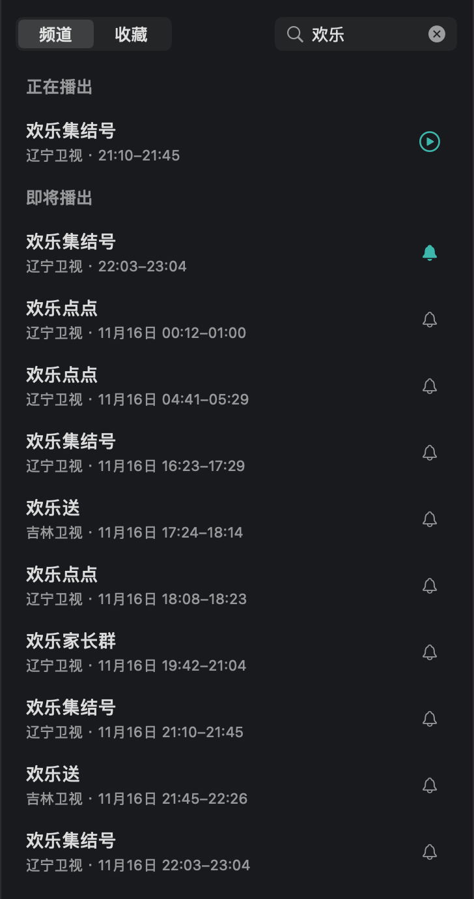

<div align="center">
  
  <h1>SofaTV</h1>
  <p><strong>Sit back on the sofa and enjoy the show.</strong></p>
  <p>A native live TV player for macOS. Flip through channels, see what's on, or keep the TV in a small window on your desktop.</p>
  <p>English · <a href="README-zh.md">简体中文</a></p>
</div>

<p align="center">
  <a href="https://www.apple.com/macos/"></a>
  
  <a href="LICENSE"></a>
</p>
<p align="center">
  <a href="https://github.com/ztygalaxy/SofaTV/releases/latest"><strong>Download SofaTV</strong></a>
  · <a href="#install">Install</a>
  · <a href="#how-to-use">How to use</a>
  · <a href="#faq">FAQ</a>
  · <a href="https://github.com/ztygalaxy/SofaTV/issues">Report an issue</a>
</p>

I've always liked watching TV. There was no need to decide what to watch first. I'd switch to a channel and see what was on. In the living room, my family would sit together, watch a show, and chat. It made an ordinary evening feel a little warmer.

Once I started working, we had fewer evenings together, so I made SofaTV.

I wanted to bring a bit of that feeling to the Mac, wherever I happen to be.

## Screenshots

<p align="center">
  <a href="docs/images/app-fullscreen.jpg"></a>
</p>
<table>
  <tr>
    <td width="14.28%" align="center"><a href="docs/images/app-idle.png"></a></td>
    <td width="14.28%" align="center"><a href="docs/images/app-playing.png"></a></td>
    <td width="14.28%" align="center"><a href="docs/images/app-fullscreen.jpg"></a></td>
    <td width="14.28%" align="center"><a href="docs/images/app-mini-player.png"></a></td>
    <td width="14.28%" align="center"><a href="docs/images/app-channel-manager.png"></a></td>
    <td width="14.28%" align="center"><a href="docs/images/app-program-reservations.png"></a></td>
    <td width="14.28%" align="center"><a href="docs/images/app-program-search.png"></a></td>
  </tr>
  <tr>
    <td align="center"><strong>Channel List</strong><br><sub>Find and favorite channels</sub></td>
    <td align="center"><strong>Program Guide</strong><br><sub>Browse listings while TV plays</sub></td>
    <td align="center"><strong>Full Screen</strong><br><sub>Open the channel list and guide</sub></td>
    <td align="center"><strong>Mini Player</strong><br><sub>Keep a resizable window on top</sub></td>
    <td align="center"><strong>Channel Sources</strong><br><sub>Manage sources and streams</sub></td>
    <td align="center"><strong>Reminders</strong><br><sub>Set, view, or cancel reminders</sub></td>
    <td align="center"><strong>Program Search</strong><br><sub>Find shows across channels</sub></td>
  </tr>
</table>

<table>
  <tr>
    <td width="50%" align="center"><a href="docs/images/dock-idle.png"></a></td>
    <td width="50%" align="center"><a href="docs/images/dock-playing.png"></a></td>
  </tr>
  <tr>
    <td align="center"><strong>Idle</strong><br><sub>Shows the SofaTV icon</sub></td>
    <td align="center"><strong>Playing</strong><br><sub>Adds the channel logo when available</sub></td>
  </tr>
</table>

## Features

| Feature | What you can do |
| --- | --- |
| Native playback | Choose video quality and latency settings, stretch the picture, and play supported web sources. |
| Program guide | Hover over a channel to see its daily schedule and jump to the current time while your channel keeps playing. |
| Program search | Find live and upcoming shows by title across channels. Click a live show to tune in or use the bell to set a reminder. |
| Program reminders | Get a notification 10 seconds before a show starts. Click it to tune in. |
| Full-screen channel browser | Reveal the channel list at the left edge to search, favorite, preview listings, or switch channels. |
| Mini player | Pin the player above other windows, move or resize it, and return to the main window at any time. |
| Channel sources | Import local or online M3U and TXT lists, merge duplicate channels, and manage streams by source. |
| Channel organization | Rename channels and groups, reorder them, and import or export your configuration. |
| Online refresh | Refresh saved online lists at launch and keep using the cached lists if a refresh fails. |
| Playback recovery | Reconnect or switch to a backup stream after a stall, network outage, or system wake. |
| Personal preferences | Keep favorites and per-channel volume, remember window and sidebar settings, and switch back to your previous channel. |
| Language and theme | Use English or Simplified Chinese with a dark, light, or system theme. |

## Install

SofaTV requires **macOS 14 or later** and runs on Apple Silicon and Intel Macs. Choose the DMG or ZIP for your Mac on the [latest release](https://github.com/ztygalaxy/SofaTV/releases/latest).

| Your Mac | Installer |
| --- | --- |
| Apple Silicon (M-series) | `SofaTV-<version>-arm64.dmg` or `.zip` |
| Intel | `SofaTV-<version>-x86_64.dmg` or `.zip` |

Open the DMG and drag the application into Applications. If you downloaded the ZIP, unzip it and move the application into Applications. The ZIP's application filename includes the version and architecture.

## How to use

### First launch

1. **Add channels.** Choose **Channels → Import Online List…**. Use the suggested URL for testing or enter your own. To load a local list, choose **Import Channel File…**.
2. **Tune in.** Click a channel in the sidebar. Use search to find channels and programs, and click a star to save a favorite.
3. **Organize your channels.** Choose **Channels → Organize Channel Groups…** to rename, group, or reorder channels. Hover over a channel to see its daily schedule.

SofaTV needs a channel source before you can watch. The suggested source is for testing and discussion.

### Channels and program guide

Use **Search channels or shows** to find channels, groups, or programs. Click a live result to switch channels. Use the bell next to an upcoming show to set a reminder. Switch to **Favorites** to search only favorite channels.

Drag the divider between the list and the video to resize the sidebar. The arrow at the left side of the player opens or closes it.

A teal bar marks the active channel. For channels with a dedicated logo, SofaTV also shows that logo on the Dock icon.

Hover over a channel to open its schedule. Scroll the panel to browse the day, click **Back to Now** to return to the current time, or move the pointer back onto the video to close the panel. The current channel keeps playing while you browse.

The guide highlights the currently watched program in teal. Other channels show **On Now**. If there is a gap in the day's schedule, the guide and channel row show the next show as **Upcoming** until it starts.

### Program reminders

Click the bell next to an upcoming show in the guide or search results. SofaTV asks for notification permission the first time you set a reminder.

macOS sends the reminder 10 seconds before the show starts. Click it to tune in. To keep it on the desktop, enable desktop notifications and choose **Persistent** in **System Settings → Notifications → SofaTV**. On older versions of macOS, choose **Alerts**.

If the banner has disappeared, you can still open it in Notification Center. SofaTV clears old reminders and notifications after the program has been over for a day.

Open **Playback → Program Reminders…** or use the button at the bottom of the guide to view or cancel reminders, or click **Watch** to tune in.

macOS notification settings, Focus, and sleep affect delivery. If a reminder is missing, check SofaTV's permission in **System Settings → Notifications**.

### Full screen and mini player

**Full screen.** Double-click the video or use the full-screen button. Move the pointer to the left edge to reveal the channel list, hover to preview the guide, or click to switch channels. Move back over the video to hide the browser. Press `Esc` to close the guide, then the channel browser, then exit full screen.

**Mini player.** Click the pin at the top right. Drag the video to move the mini player, and drag its edges to resize it proportionally. Click the pin again, double-click the video, or press `Esc` to return.

Playback continues while you move between the main window, full screen, and the mini player. Move the pointer to reveal playback controls.

**Stop playback.** Click the power button next to the pin or choose **Playback → Stop Playback**. Full screen and the mini player return to the main window. Playback stays stopped after a network reconnection or system wake.

### Volume and playback

- **Volume.** Scroll over the video or use the volume slider. SofaTV remembers the volume for each channel.
- **Mute.** Click the speaker. Mute carries over when you switch channels. Click the speaker again to unmute.
- **Reload.** Use the reload button near the volume slider to reconnect to the current stream.
- **Playback options.** Use the **Playback** menu to choose video quality, switch between **Stable**, **Balanced**, and **Low Latency**, or enable **Stretch Video**. Available quality depends on the stream.
- **Previous channel.** Choose **Back to Previous Channel** to return to the last channel you watched.

### Settings

Open **SofaTV → Settings…** or press `⌘,`. The theme defaults to **Dark**. You can also choose **Light** or **Follow System**.

The interface follows the Mac's primary language by default. Chinese uses Simplified Chinese, and other system languages use English. You can switch to **English** or **简体中文** instantly in Settings.

### Channel sources

| Source | Menu command |
| --- | --- |
| Local M3U or TXT file | Channels → Import Channel File… |
| Online M3U or TXT list | Channels → Import Online List… |
| A single live stream | Channels → Open Stream URL… |

Open **Channels → Manage Channel Sources…** to view imported lists, refresh an online source, or delete a list. Click a source to inspect its channels. Expand a channel to copy or remove its streams.

Channels with the same name and group share streams. Deleting a channel or stream from a source affects that source; duplicates from other sources remain. In the main window, right-click to delete a channel or group. To switch streams manually, use **Playback → Stream**.

### Organize channels and groups

Open **Channels → Organize Channel Groups…**.

- **Channels.** Drag rows or use the arrow buttons to move them. Click the pencil to change a channel's display name or group. Enter a new group name to create a group, or choose an existing one.
- **Groups.** Reorder or rename groups. Using an existing group name merges the groups. Clear the search to resume drag-based reordering.
- **Restore Default Order.** Restore the source's channel order and the default group order. Custom names and group assignments are preserved.
- **Import or export configuration.** Back up or restore sources, favorites, ordering, display names, groups, and volume using JSON. SofaTV asks before restoring a configuration and stops playback if you proceed. An unsupported file leaves the current configuration intact.

Display names and groups are local to the app. The guide matches channels using their original information. Refreshing an online source preserves settings for channels SofaTV can match.

### Online refresh

At launch, SofaTV shows the cached list for each online source and checks for updates in the background. If a source fails to refresh, its cached list remains available. An update does not interrupt current playback.

Choose **Channels → Refresh Channel Lists** to check every online source. Use **Manage Channel Sources…** to refresh a single source and see its last check or error.

SofaTV remembers channels and streams removed from an online source. To bring them back, choose **Restore Removed Items** in the source details. To restore an entire deleted source, import it again.

<details>
<summary>M3U and TXT examples</summary>

M3U uses `group-title` to assign a group.

```m3u
#EXTM3U
#EXTINF:-1 group-title="Example Group",Example Channel
https://example.com/live.m3u8
```

In TXT, use `Channel Name,URL` for a channel and `Group Name,#genre#` to start a group.

```text
Example Group,#genre#
Example Channel,https://example.com/live.m3u8
```

Replace the example addresses with working stream URLs.

</details>

### Shortcuts

| Shortcut | Action |
| --- | --- |
| `↑` / `↓` | Previous or next channel |
| `←` / `→` | Lower or raise channel volume |
| Double-click video | Toggle full screen or return from the mini player |
| `Esc` (full screen) | Dismiss the guide or channel browser, then exit full screen |
| `Esc` (mini player) | Return to the main window |
| `⌘,` | Open Settings |
| `⌘O` | Import a channel file |
| `⇧⌘O` | Import an online list |
| `⌘L` | Open a stream URL |

## FAQ

<details>
<summary>Why are some channels slow to connect or unavailable?</summary>

Connection speed depends on the source and network. Some web sources also need time to resolve the stream. Try reloading, switching streams under **Playback → Stream**, or choosing **Channels → Refresh Channel Lists** if the address has expired.

SofaTV prefers native playback and can fall back to web playback for supported sources.

</details>

<details>
<summary>Does SofaTV recover from a dropped stream?</summary>

SofaTV tries to reconnect after a stall or dropped stream and switches to a backup if available. It waits for the network to return when offline and reconnects after system wake. If it exhausts the available streams, you can reload manually or switch channels.

</details>

<details>
<summary>Why is the guide missing for some channels?</summary>

Listings depend on the available guide data and how well channel names or identifiers match it. Coverage varies by channel. A channel can play even when it has no guide.

</details>

<details>
<summary>How do I update SofaTV?</summary>

SofaTV checks for updates in the background after launch and avoids showing automatic prompts while you watch. To check manually, choose **SofaTV → Check for Updates…**.

**Download and Install** downloads and verifies the ZIP for your Mac, then replaces and reopens the app. Your channels and settings are kept. You can also choose **Later** or **Skip This Version**. A manual check can still show a skipped version.

See [Releases](https://github.com/ztygalaxy/SofaTV/releases) for version history and release notes.

</details>

## Data and privacy

Channel lists, favorites, viewing history, reminders, volume, mute, display names and groups, ordering, window layout, language, and theme are stored on your Mac.

Web playback uses temporary website data. Playback cookies are kept only for the current app session.

## Development and contributions

SofaTV uses **Swift 6, SwiftUI, AppKit, AVKit, and WebKit**. Open an [issue](https://github.com/ztygalaxy/SofaTV/issues) to report a problem or suggest an idea, or submit a pull request. See the [contributors](https://github.com/ztygalaxy/SofaTV/graphs/contributors).

To build locally, install a Swift 6 toolchain, Python 3, and Clang on macOS 14 or later. Xcode or Command Line Tools provides Swift and Clang.

```sh
git clone https://github.com/ztygalaxy/SofaTV.git
cd SofaTV
./scripts/build-app.sh
```

The application bundle is written to `dist/沙发电视.app` and includes the libraries, icons, and resources needed for playback.

Build a ZIP and DMG for the current architecture.

```sh
./scripts/package-app.sh
```

Run the core checks.

```sh
./scripts/test-core.sh
```

## License and sources

SofaTV is licensed under the [GNU General Public License v3 only](LICENSE) (`GPL-3.0-only`). Third-party and derived source files retain their own copyrights and licenses. See [Channel logo sources](Assets/ChannelLogos/SOURCE.md).

Rights to channel names, websites, logos, and media belong to their respective owners. Follow local laws and provider terms when using or distributing source lists. SofaTV does not provide rights to external content or guarantee stream availability.

The suggested online source is publicly available and intended for development and testing. For a takedown request, [contact the maintainer](mailto:zhangty1996@163.com).
